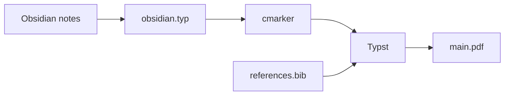

Obsidian is a comfortable place to write: notes are plain markdown files, links between them are easy, and nothing locks you in. Handing in a formatted report from those notes usually means copying everything into a word processor and fixing the layout by hand.

This template removes that step. The notes stay the source of truth, and the PDF is generated from them whenever you need it, as shown in [@pipeline].

# Goals

- Write in Obsidian, with all its linking, searching and plugins.
- Get a consistently formatted PDF with one command.
- Keep citations in Zotero and have the reference list generated automatically.
- Work together through git, because every note is a small text file.
