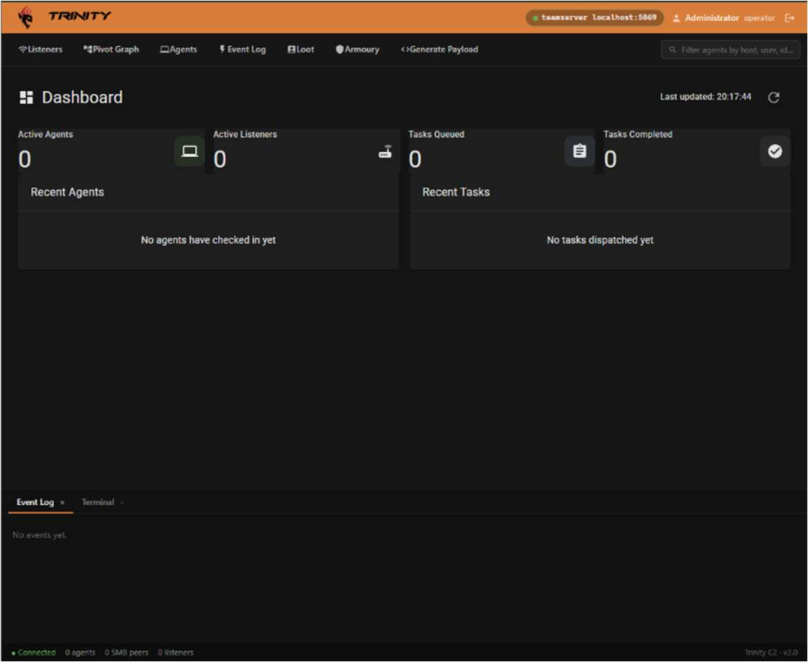

<!-- Original PDF page 1 -->
## UI Overview

The Dashboard is the first page you see after logging in and gives a live snapshot of the operation at a glance. The dashboard is read only and no actions can be taken from here. Use the navigation bar at the top to navigate to Agents, Listeners or Payloads to interact.

### Stat Cards

| Card | What it shows |
|---|---|
| Active Agents | Agents that have checked in within the last 2 minutes |
| Active Listeners | Number of running HTTP listeners |
| Tasks Queued | Commands waiting to be picked up by an agent |
| Tasks Completed | Commands confirmed as finished |

### Panels

- Recent Agents- Lists agents that have checked in most recently with online and oƯline status indicator dot and how much time has elapsed since they last checked in - Recent Tasks- Shows the latest dispatched commands with their status badge and timestamp.

### Refreshing

Click on the refresh button in the top right of the page header to reload all data where the last updated timestamp will update automatically.
