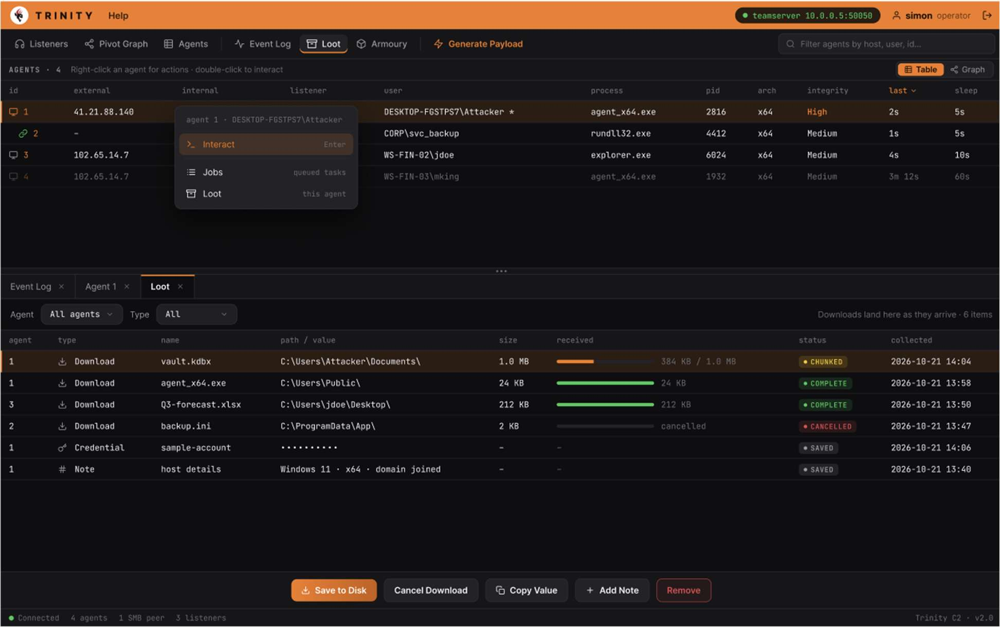
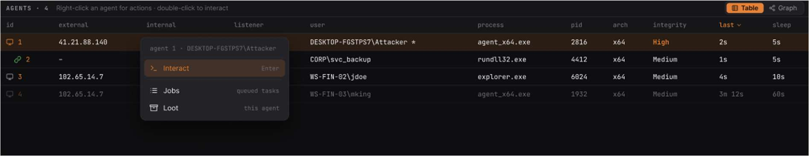

# KAN 124

<!-- Original PDF page 1 -->

## Data Management

The Loot page collects all data retrieved from agents during an operation such as; downloaded file, captured credentials and operator notes.

### Filtering

- Agent- Filter will only show loot from a specific agent. - Type- Allows the operator filter by Download, Credentials or Notes.

---

<!-- Original PDF page 2 -->

### Loot Table Columns

| Column | Description |
|---|---|
| Agent | The agent ID that the item came from |
| Type | Download, Credentials or Note |
| Name | File name or credentials label |
| Path/Value | Remote path for downloads; masked for credentials |
| Size | File size |
| Received | Progress bar for current downloads |
| Status | Complete, partial, pending and failed |
| Collected | Timestamp for when the item has arrived |
