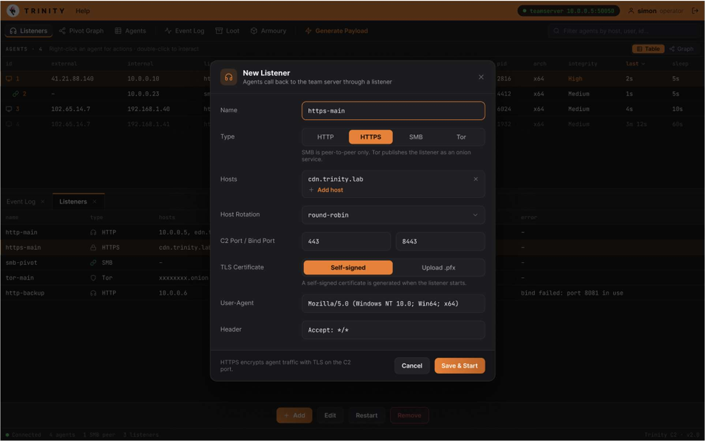

# KAN 125

<!-- Original PDF page 1 -->

## Listener Management

Listeners are network services that the agents will connect back to, this page will let you create, monitor and remove them.

### Listener Table

| Column | Description |
|---|---|
| Name | The label given when the listener was created |
| Protocol | HTTP, HTTPS, etc |
| Host | Bind address |
| Port | Listening port |
| Status | Green for active and Grey for stopped |

### Creating a listener

1. Click +New Listener in the top right.
2. Fill in Listener Name (e.g. HTTP-001), Bind Address (e.g. 8.0.8.0) and Port.
3. Click Create. The listener will then appear in the table with an active status.
