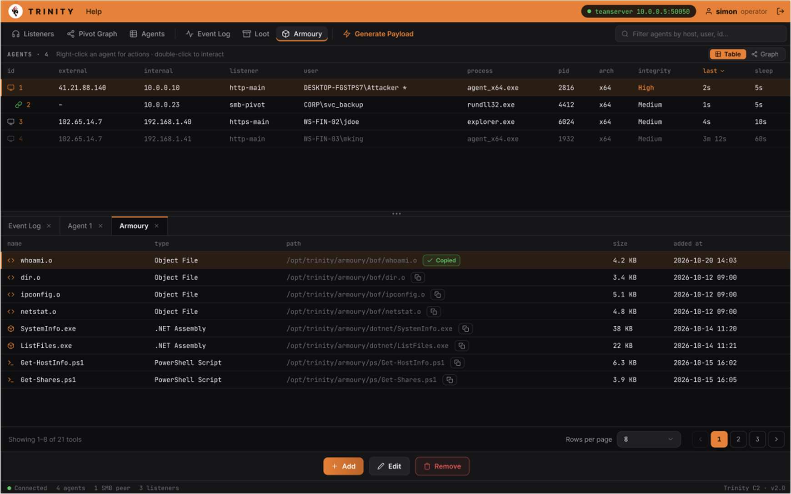
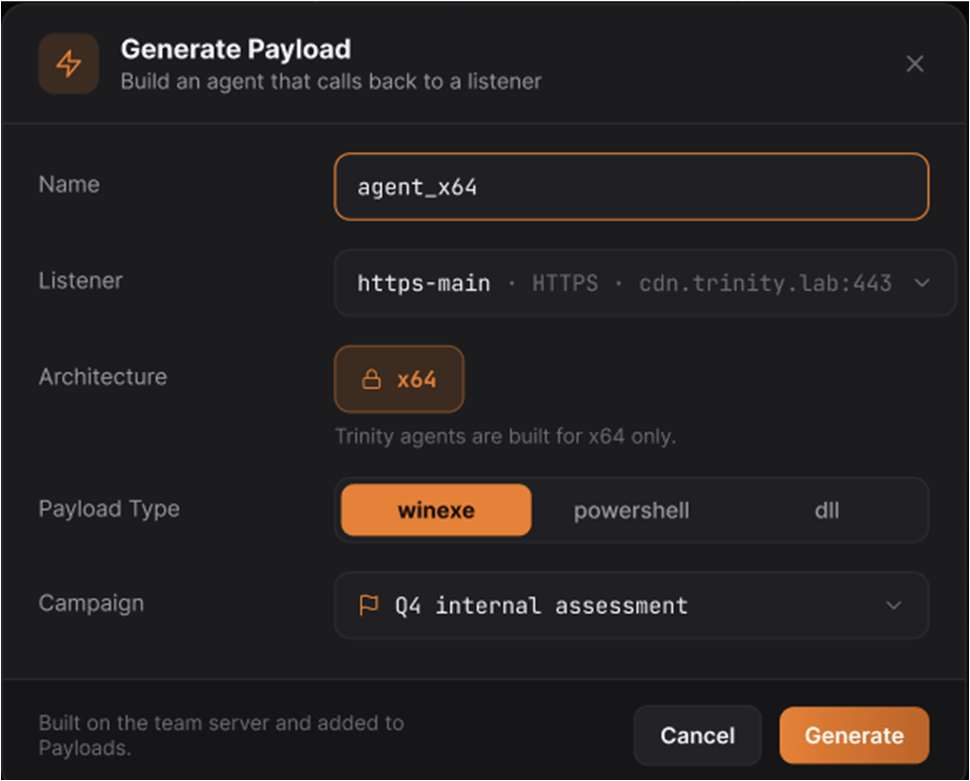

# KAN 126

<!-- Original PDF page 1 -->

## Payload Management UI

The Payload Page (Armoury) stores the generated agent payloads and lets you create new ones for deployment. Payloads are stored on the server, you can navigate to Loot to review files that agents have sent back during campaigns.

### Payload Table

| Column | Description |
|---|---|
| Filename | The generated files name |
| Type | Payload format and type badge (e.g. .exe, .dll) |
| Size | File size |
| Created | Date and time that the payload was generated |

---

<!-- Original PDF page 2 -->

### Generating Payload

1. Click the Generate button in the top right of the Armoury screen
2. Fill in the generation form; select the listener, output format and any other relevant

options. 3. Click Generate and the new payload will appear in the table once complete.

