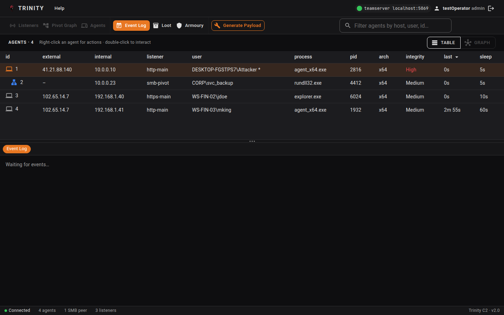
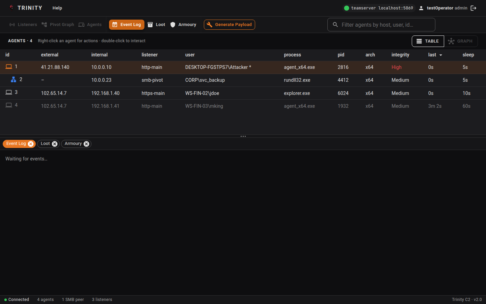
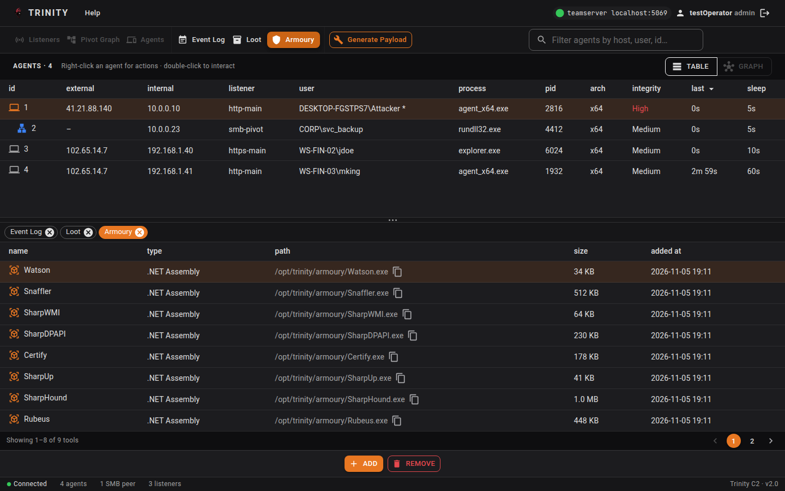
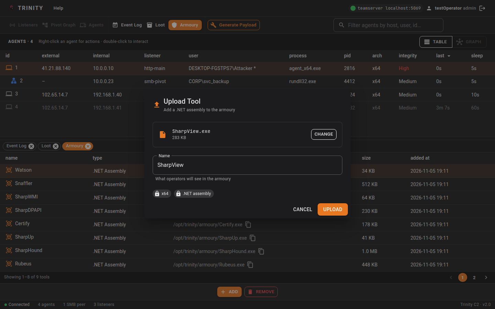
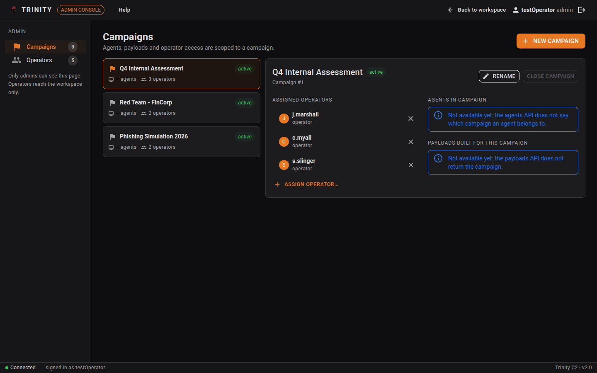
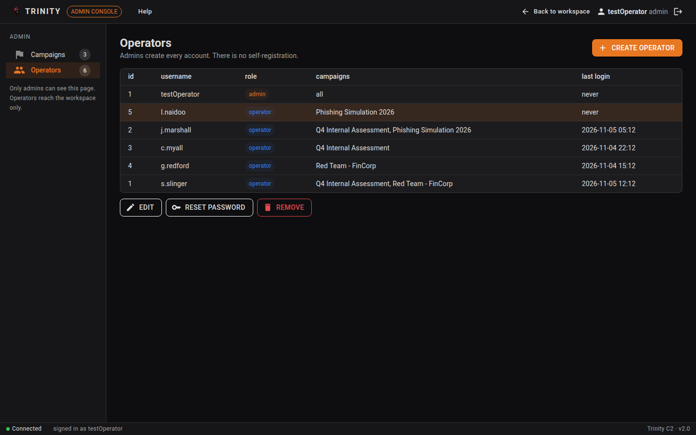

# 1. Toolbar (KAN-119)

The toolbar runs across the top of the operator workspace in two rows: the top bar and the navigation row. A status bar runs along the bottom.

## 1.1 Top bar

|Item|What it does|
|---|---|
|**TRINITY** logo|Shows you're in the operator workspace.|
|**Help**|Not linked to anything in this version.|
|**Team server status**|Shows the team server's address, for example `teamserver localhost:5069`. A green dot means it's reachable, a red dot means it isn't.|
|**Your name and role**|Shows who is signed in. If you're an admin, click it to open the admin console.|
|**Sign out** (arrow icon)|Ends your session and returns you to the sign-in page.|

## 1.2 Navigation row

|Button|Opens|
|---|---|
|**Event Log**|Live list of events for your campaigns (see 1.5).|
|**Loot**|Data collected from agents.|
|**Armoury**|Tools you can upload and run on agents (see section 4).|
|**Generate Payload**|Opens the Payloads screen with the Generate Payload dialog open, to build a new agent.|
|**Listeners**, **Pivot Graph**, **Agents**|Greyed out in this version. Hover over one to see why.|

The **filter box** on the right narrows the agents table as you type. It matches the agent ID, user (which includes the host name, such as `DESKTOP-FGSTPS7\Attacker`), internal or external IP, or process name.

## 1.3 Status bar

The bar along the bottom shows whether the team server is reachable (**Connected** or **Disconnected**), how many agents, SMB peers and listeners there are, and the Trinity version. The agents table refreshes every 5 seconds and the connection status every 15 seconds.

## 1.4 Action bar

Pages that act on a selected row (Payloads, Loot, Armoury) have an action bar at the bottom with their buttons, for example **Generate**, **Save to Disk** and **Remove** on Payloads, or **Add** and **Remove** on Armoury. Buttons that can't be used yet are greyed out; hover over one to see why.

## 1.5 Event Log

The Event Log shows events for the campaigns you're assigned to (admins see every campaign). Each row has the time, the type of event (such as **PAYLOAD** or **OPERATOR**) and a message. Events arrive live while you're signed in, even when you're on another screen, and the newest 500 are kept. Events from before you signed in aren't shown.

In this version the team server is set up to send events when:

- a payload is built, or fails to build
- an operator is added to or removed from a campaign

If you aren't on any campaign yet, the Event Log says so instead of showing events.

---

# 2. Preferences: look and feel (KAN-120)

Trinity uses a single dark theme with orange highlights across every screen. Agent data, such as IDs, IP addresses and tool paths, is shown in a monospaced font so values line up in the tables. In this version the theme and fonts are fixed and can't be changed.

---

# 3. Working with tabs (KAN-123)

Each screen you open from the navigation row opens as a tab in the strip below the agents table, so you can switch between screens without losing your place.

- **Open a tab:** click a button in the navigation row. If the tab is already open, Trinity switches to it instead of opening a second one.
- **Switch tabs:** click a tab. The current one is highlighted in orange.
- **Close a tab:** click the **×** on it. The last tab has no **×**, so there's always one screen open.
- The **Event Log** tab is open when you first sign in.

The **agents table** stays above the tabs on every screen. Drag the bar between them to give the table more or less room.

- Click an agent to select it.
- Double-click an agent to open its terminal.
- Right-click an agent for more actions: **Interact** opens its terminal, and **Loot** opens the Loot screen showing only that agent's loot. **Jobs** is greyed out in this version.

---

# 4. Armoury management (KAN-127)

The Armoury holds the tools (.NET assemblies) operators can run on agents. Open it with **Armoury** in the navigation row.

## 4.1 The tools list

The table lists every tool stored on the team server, newest first, showing each tool's name, type, path on the team server, size and when it was added. It shows 8 tools per page; use the page numbers under the table to see the rest.

- **Select a tool:** click its row. The selected row is highlighted in orange.
- **Copy a tool's path:** click the copy icon next to the path. It briefly changes to **Copied**.

If the team server can't be reached, a warning appears above the table with a **Retry** button.

## 4.2 Uploading a tool

1. Click **Add** in the action bar.
2. Click the file box and choose a **.exe** or **.dll** (up to 50 MB).
3. Check the **Name**. It's filled in from the file name, and it's what other operators will see.
4. Click **Upload**.

When the upload finishes, a message confirms it and the tool appears at the top of the list. Tools are always stored as x64 .NET assemblies.

If the upload fails, the dialog says why: for example, if a tool with that file name is already in the Armoury, if the team server can't be reached, or if your account isn't in the operator list.

## 4.3 Example

To add SharpView to the Armoury:

1. Click **Add**.
2. Choose `SharpView.exe`. The dialog shows the file and its size, and fills in the name **SharpView**.
3. Click **Upload**.

SharpView now appears at the top of the tools list, and its path can be copied for use in an agent command.

## 4.4 Removing a tool

1. Click the tool's row to select it.
2. Click **Remove** in the action bar.
3. Click **Remove** in the confirmation box.

This deletes the tool's file from the team server, so it can't be undone. To change a tool, remove it and upload the new version.

---

# 5. Campaign management (KAN-128)

A campaign groups the operators, agents and payloads for one engagement. Campaigns are managed in the admin console.

## 5.1 Opening the admin console

The admin console is for admins: only admins get the link to it. An admin gives someone admin access by creating their account with the **Admin** role (see section 6.1). Admins can see every campaign.

Admins are taken to Campaigns when they sign in. From the operator workspace, click your name in the top bar. Use **Back to workspace** to return.

The sidebar has **Campaigns** and **Operators**, each showing a count.

## 5.2 Creating and renaming a campaign

Click **New Campaign** to open the **Create New Campaign** dialog. It asks for a campaign name, description, campaign type, target and delivery method. In this version, clicking **Confirm** closes the dialog without creating the campaign.

To rename a campaign:

1. Click its card to open it.
2. Click **Rename**.
3. Enter the new name and click **Rename** in the dialog.

## 5.3 Assigning operators

Each campaign card lists its **assigned operators**.

- **Add an operator:** click **Assign operator…** and pick a name. Operators already on the campaign aren't listed; if everyone is assigned, the menu says so.
- **Remove an operator:** click the **×** next to their name.

**Close Campaign** is greyed out in this version, and the **Agents in campaign** and **Payloads built for this campaign** panels show a "Not available yet" notice.

---

# 6. Operator management (KAN-129)

Admins manage operator accounts from **Operators** in the admin console sidebar. The table shows each account's ID, username, role, campaigns and last login. Admins show **all** under campaigns.

## 6.1 Creating an operator

1. Click **Create Operator**.
2. Enter a **Username**, **Password** and **Confirm Password**.
3. Choose a **Role**: **Operator** or **Admin**.
4. For an operator, pick the **Campaigns** they should work on (you can choose several). Admins can see every campaign, so they don't need any.
5. Click **Create Operator**.

## 6.2 Passwords

Every operator needs a password. The team server doesn't enforce any other rules (such as length), so choose strong passwords.

To reset a password, select the account, click **Reset Password**, enter the new password in **Password** and **Confirm Password**, and click **Reset Password** in the dialog.

## 6.3 Editing and removing operators

Select an operator in the table, then:

- **Edit** changes their username, and for operators, their campaigns. The role can't be changed after the account is created, and their password stays the same. Click **Save Changes** to apply.
- **Remove** deletes the account. Click it a second time to confirm.