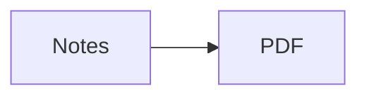

Typst can't download anything itself, so `./toolbox.sh build` and `./toolbox.sh watch` do it just before building.

- **Web images and PDFs**, written as `` or ``, are downloaded once into the hidden `.cache/` folder. The PDF still builds offline afterwards. If a download fails, or the link isn't an image or PDF, it becomes a normal link and the toolbox prints a warning.
- **Mermaid diagrams** are rendered to images by [mermaid.ink](https://mermaid.ink), the rendering service of [mermaid.live](https://mermaid.live). A diagram is only rendered again when its code changes. If rendering fails, the PDF shows the diagram's code instead.

To make a diagram a numbered figure, add a caption and an id as Mermaid comments at the top. Obsidian ignores these lines:

````markdown

````

You can then refer to the diagram with `[@pipeline]`, as shown in [@pipeline].

# Keeping Web Images

`.cache/` isn't committed to git, so everyone in a group downloads their own copy. To store web images permanently in the vault instead, for example in case a website disappears, run:

```bash
./toolbox.sh localize
```

This copies every web image into the `attachments` folder next to the note that uses it and changes the link to point there. To do this on every build, set `LOCALIZE_ON_BUILD=true` near the top of `toolbox.sh`.
